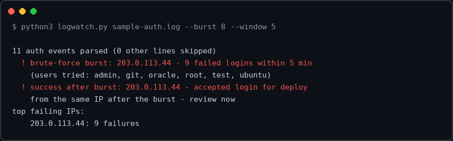

# logwatch

SSH `auth.log` anomaly detector. Flags brute-force bursts (many failed logins from one IP inside a short window) and the case that matters most: a *successful* login from an IP right after it failed a burst.

Original code, stdlib only.

## Use

```sh
python3 logwatch.py /var/log/auth.log
python3 logwatch.py auth.log --burst 8 --window 5 --json
```

Output lists each alert with the IP, the accounts it tried, and the top failing IPs. Exit code 1 when alerts exist, so cron can mail you only when something fired.

Parses standard OpenSSH formats, including `Failed password for invalid user ...`. Lines it does not recognize are counted as skipped, never silently dropped.

## Tests

```sh
python3 -m unittest discover -s tests -v
```

## Sample output (real run)

```
$ python3 logwatch.py sample-auth.log --burst 8 --window 5

11 auth events parsed (0 other lines skipped)
  ! brute-force burst: 203.0.113.44 - 9 failed logins within 5 min
    (users tried: admin, git, oracle, root, test, ubuntu)
  ! success after burst: 203.0.113.44 - accepted login for deploy
    from the same IP after the burst - review now
```


